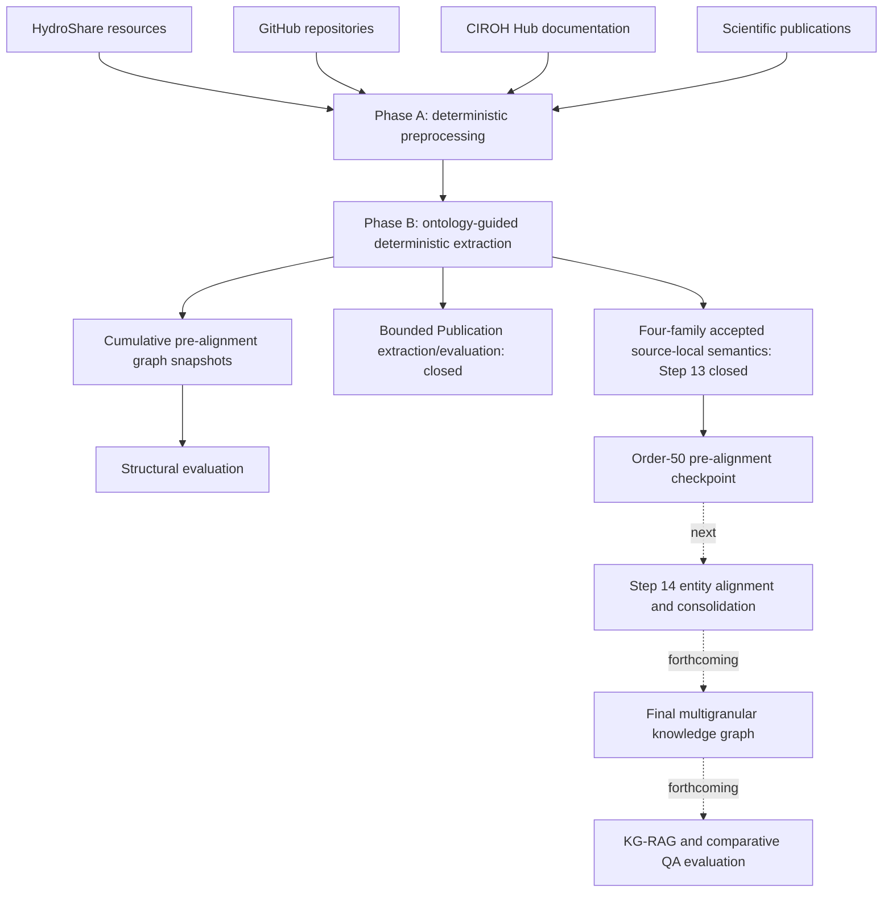

# Multigranular KG-RAG for Operational Hydrology

> **Project status — November 2, 2026:** Study 2 Steps 1–13 are closed within their documented scopes; ontology **v0.1.7** is formally frozen. Accepted four-family source-local semantic production and the promoted order-50 pre-alignment structural checkpoint are complete. **Step 14 alignment is the next separately authorized workstream**; alignment, final KG assembly and Study 3 retrieval/QA have not begun through this milestone. See the [operational handoff](docs/codex/CODEX_HANDOFF.md) and [Step 13 completion record](docs/handoffs/STUDY2_STEP13_COMPLETION_ACCEPTANCE.md).

This repository supports the construction and evaluation of an ontology-guided, multigranular knowledge graph and KG-RAG system for **scientific cross-artifact question answering in operational hydrology**.

Scientific knowledge is distributed across publications, datasets, source-code repositories, and technical documentation. The project represents these heterogeneous artifacts in a common, provenance-aware graph while preserving both:

- **inter-artifact structure**, such as connections among papers, datasets, repositories, tools, organizations, and documentation; and
- **intra-artifact structure**, such as sections, files, contributors, dependencies, variables, methods, evidence spans, and other artifact-specific components.

The current corpus is centered on artifacts associated with the **Cooperative Institute for Research to Operations in Hydrology (CIROH)**.

## Research scope

The repository supports two connected dissertation studies:

1. **Ontology and multigranular knowledge-graph construction** over heterogeneous scientific artifacts.
2. **Scientific workflow-aware graph retrieval and KG-RAG** for cross-artifact question answering in operational hydrology.

The intended final system will be evaluated against non-retrieval, web-search, vector-RAG, and GraphRAG baselines built under a controlled comparison design.

## Current milestone

| Component | Accepted status |
|---|---|
| Ontology formalization and HermiT gate | v0.1.7 formally frozen; validation limitations below |
| Four-family deterministic extraction | Accepted pre-alignment baseline; HydroShare v0.1.6 corrections and GitHub/Hub reference enrichment accepted |
| Cumulative structural evaluation | Order 10–40 deterministic checkpoints preserved; order 50 accepted semantics and approved derivations promoted, with full and file-inventory-excluded views |
| Step 7 — Publication Human Core N=5 | Frozen/closed; strict evaluation primary, researcher-reviewed results secondary |
| Step 8 — complementary Publication N=6 review | Accepted/frozen/closed; candidate-conditioned review, not exhaustive extraction evaluation |
| Step 9 — SciERC external evaluation | Accepted/frozen/closed; strict/post-run results and separately qualified secondary analyses |
| Step 10 — source-specific semantic-gap decisions | Closed |
| Steps 1–6 — foundations and bounded Publication preparation | Closed within their recorded scopes; historical authorities preserved |
| Step 11 — source-specific semantic contracts | Closed / accepted |
| Step 12 — technical integration and bounded pilot | Closed / accepted |
| Step 13 — four-family source-local production | Closed / accepted, including documented exceptions and retrospective diagnostic limits |
| Step 14 onward | Alignment next; final assembly and subsequent evaluation/retrieval work remain separate |

The earlier bounded Publication evaluations and the completed full-corpus production are distinct authorities. Production acceptance does not convert bounded evaluation results into corpus-wide accuracy estimates or establish a final aligned KG.

- [Step 7 closure](data/curation/papers/m2/human_core_gold/publication_human_core_n5_corrected_evaluation_step7c_closure_v1.0.0.md) preserves the corrected evaluation against the bounded, model-blind Human Core N=5 reference and the primary/secondary distinction.
- [Step 8 acceptance](docs/evaluation_decisions.md#step-8-researcher-acceptance--accepted--frozen_closed) binds the [frozen closure](data/curation/papers/m2/publication_step8_final_evaluation/publication_step8_closure_freeze_v1.0.0.json). Two independent reviews covered the same 182 candidates across N=6 before joint reconciliation; 179 assertions were supported (130 nodes, 49 relations). Candidate-support agreement is not extraction inter-annotator agreement, and this review does not establish recall or completeness.
- [Step 9 closure](data/curation/papers/m2/scierc_step9_closure_v0.1.0.json) retains the disclosed failure-handling policies. Mechanical-overlap sensitivity is not semantic adjudication; LLM-assisted contextual equivalence is secondary analysis, not independently human-adjudicated gold or a replacement extraction score.

## Pipeline



Phase A parses and normalizes source-specific records without creating graph entities. Phase B applies frozen mappings to create ontology-aligned nodes, edges, attributes, and provenance records. The cumulative checkpoints preserve deterministic modules and accepted source-local occurrences, with governed exact owner/request handling and pipeline-derived relationships. They perform no name-based or cross-source semantic alignment.

## Current ontology

The canonical ontology is **v0.1.7, formally frozen**. Historical Publication production, annotation and evaluation keep their original version bindings; the current freeze does not rewrite them.

- [Specification](src/ontology/ontology_spec.yaml), [generated OWL](src/ontology/ciroh_ontology.owl), and [unchanged generator](src/ontology/build_ontology.py).
- Validated OWL SHA-256: `ac64435ca02a703bdee8168a045a3897d7f6f5be1a8e25e6cdf485c66c85e0fa`.
- v0.1.7 extends C-C15 `usesDataset` and C-DC25 `mentionsDataset` ranges to `DatasetResource | DatasetMention`; use and weak mention remain distinct.
- The recorded focused build suite passed 46 tests. Researcher-run HermiT classification completed in 38,931 ms, with no reported errors/inconsistency and zero named unsatisfiable classes.

The manual reasoner result applies to that exact artifact and import configuration. It does not establish complete third-party import resolution, instance-graph validity, extraction accuracy or scientific truth. See [formalization §13](docs/ontology_formalization.md#13-dataset-range-amendment-017-formally-frozen) for the current gate and preserved historical limitations.

## Accepted semantic production and its scientific boundary

The selected HydroShare, GitHub and CIROH Hub outputs are the **v4.1 source-local projection**: 335 complete owners (42 HydroShare, 51 GitHub, 242 Hub), with **4,986 owner-level nodes and 4,403 edges**. Their 1,005 group reports contain 9,463 admissions; group occurrences and owner-consolidated records are different counting units. Publications retains **10,886 completed-protected requests and seven terminal exceptions**, with 182,255 accepted node occurrences and 89,021 edge occurrences—not globally distinct entities.

For the three non-Publication families, source-specific automated construction acceptance combines exact evidence/source validation, ontology signatures, endpoint identity, independent relation evidence, dependency closure and duplicate controls. The **30-request Step 12 pilot** was bounded calibration and technical evidence, including a predeclared held-out qualitative challenge; it was not a population evaluation. A later **12-case post-production diagnostic** sampled two ordinary and two conditional admissions per family: **11 Supported, one Questionable (R03)**. Those judgments were **researcher-confirmed and ChatGPT-assisted**, not independent or blinded evaluation; sampling was not predeclared before extraction. R03's semantic-typing concern remains recorded without retyping or excluding the accepted candidate. Three separately approved v4.1 reviewer corrections and six quarantined malformed abstentions remain traceable.

Neither automated acceptance, the pilot nor these diagnostic judgments establishes **population semantic precision, recall, F1 or completeness**. No independent gold or exhaustive coverage claim is implied. See [Step 12 closure](docs/handoffs/STUDY2_STEP12_COMPLETION_ACCEPTANCE.md), [Step 13 closure](docs/handoffs/STUDY2_STEP13_COMPLETION_ACCEPTANCE.md), and [confirmed judgments](docs/evaluation/study2_step13_diagnostic_review_confirmed_2026-10-30.json).

## Promoted order-50 pre-alignment checkpoint

| View | Nodes | Edges | Information density | Relational richness |
|---|---:|---:|---:|---:|
| Full | 215,653 | 337,562 | 4.471021 | 1.617979 |
| File-inventory-excluded | 202,952 | 324,619 | 4.495861 | 1.653825 |

The evaluation-only v4 snapshot adds **211,329 approved derived relationships**, including the 407 governed non-Publication construction inputs, with **67,928 generic mentions suppressed by precedence**. It preserves original source-local occurrences and historical provenance. **472 zero-degree nodes remain**: 445 literal evidence-bound occurrences outside active D-26 profiles, four Hub provenance-only records and 23 deterministic Publication bibliographic Tool stubs. The bounded audit found no clearly justified existing-rule repair within its scope. Potential weak-mention extensions require separate prospective approval; isolation is not a mandate to create edges.

These are structural measures of the frozen scope, not accuracy or final canonical-entity counts. The file-inventory-excluded view is sensitivity analysis, not a replacement graph. Step 15 must provide an explicitly navigable evidence-grounded source provenance path for every retained entity, separately from substantive semantic relationships. A zero-degree audit is not a complete source-reachability audit. See the [order-50 promotion record and exact hashes](docs/study2_order50_frozen_scope_checkpoint.md).

## Deterministic graph trajectory

The preserved order-10/20/30/40 deterministic checkpoints contain:

| Construction point | Nodes | Edges |
|---|---:|---:|
| HydroShare (v0.1.6 corrections) | 1,303 | 1,628 |
| + GitHub (reference enrichment) | 14,083 | 14,393 |
| + CIROH Hub (reference enrichment) | 18,750 | 21,037 |
| + Publications | 28,406 | 32,809 |

These are **pre-alignment** snapshots. A node consolidation ratio of 1.0 at this stage reflects mention-level representation before cross-source entity resolution.

The repository reports two structural views:

- `full`: the primary description of the actual deterministic graph; and
- `file_inventory_excluded`: a supporting sensitivity analysis that excludes ontology classes used for explicit file inventories.

The **order-40 deterministic** file-inventory-excluded view contains **15,705 nodes and 19,866 edges**. The filtered view does not modify the KG and is not a substitute for the full graph. See [`results/metrics/trajectory.md`](results/metrics/trajectory.md) and [`docs/evaluation_decisions.md`](docs/evaluation_decisions.md).

The [accepted HydroShare corrections](docs/handoffs/STUDY2_HYDROSHARE_V016_ACCEPTANCE.md) added 15 own-resource DOI Identifier/hasIdentifier pairs and aligned 18 contributor and 21 funding-agency edges to C-D27/C-D28 without changing their relation semantics or endpoints. The [accepted reference enrichment](docs/handoffs/STUDY2_REFERENCE_ENRICHMENT_V1_ACCEPTANCE.md) adds **59 GitHub C-C27 referencesRepository edges** and **91 Hub C-DC22 references edges**. Generic references do not establish use, implementation, dependency, identity, scientific correctness, or exhaustive coverage. Exact accepted graph hashes are in the [prospective manifest](tests/fixtures/reference_enrichment/prospective_hashes.json).

`DataService`/`servesDataset` are declared in the ontology, but service extraction is not activated. Heuristically generated HydroShare `data_services` are not verified WMS/WCS service assertions and are not admissible evidence for published services; service materialization remains deferred.

## Repository organization

```text
data/
  curation/                     Version-controlled curation decisions
  raw/                          Locally materialized source snapshots
  interim/                      Generated corpora and graph artifacts, generally ignored

docs/                            Ontology, preprocessing, extraction, and evaluation records

notebooks/                       Corpus acquisition and exploratory workflows

results/metrics/
  modules/                       Module-level structural metric records
  snapshots/                     Cumulative metric snapshots
  history/                       Preserved superseded metric records and trajectories
  trajectory.md                 Cumulative trajectory through order 50

src/
  ontology/                      Ontology specification, builder, imports, and OWL artifact
  preprocessing/                 Source-specific deterministic Phase A corpus builders
  extraction/deterministic/      Phase B extractors and mapping contracts
  evaluation/                    Snapshot assembly and structural metrics

tests/                           Unit, regression, contract, and frozen-snapshot tests
```

### Meaning of the metric directories

- [`results/metrics/modules/`](results/metrics/modules/): source/module-only structural diagnostics. They describe an individual module and are **not additional cumulative trajectory checkpoints**.
- [`results/metrics/snapshots/`](results/metrics/snapshots/): canonical cumulative **metric JSON records**, not the full graph files. Each preserves its measurement ID/order, graph input path/hash, counting policy, full/filtered results and per-class accounting. Orders 10–40 are deterministic; order 50 is pre-alignment accepted semantics plus approved derivations.
- [`results/metrics/history/`](results/metrics/history/): deliberately retained earlier records and trajectories, including pre-correction/reference-enrichment states. These explain methodological history and remain immutable; they are not extra current trajectory rows.
- [`results/metrics/trajectory.md`](results/metrics/trajectory.md): readable cumulative tables rendered from current saved snapshot records, with full, sensitivity and delta views. It does not generate a graph or new measurement. Historical metric IDs, files and hashes are preserved.

## Documentation map

### Ontology

- [Conceptual ontology](docs/ontology_v0.1.md)
- [Ontology inventory](docs/ontology_inventory.md)
- [OWL/RDF formalization and reasoner validation](docs/ontology_formalization.md)

### GitHub repositories

- [Phase A preprocessing record](docs/github_preprocessing_phaseA.md)
- [Phase B deterministic extraction record](docs/github_extraction_phaseB.md)
- [Extraction mapping](src/extraction/deterministic/github_extraction_mapping.md)

### CIROH Hub documentation

- [Phase A preprocessing record](docs/ciroh_hub_preprocessing_phaseA.md)
- [Phase B deterministic extraction record](docs/ciroh_hub_extraction_phaseB.md)
- [Extraction mapping](src/extraction/deterministic/ciroh_hub_extraction_mapping.md)

### Publications

- [Phase A preprocessing record](docs/publication_preprocessing_phaseA.md)
- [Phase B deterministic extraction record](docs/publication_extraction_phaseB.md)
- [Extraction mapping](src/extraction/deterministic/publication_extraction_mapping.md)
- [Final Publication Pilot 1 LLM target inventory](docs/publication_llm_extraction_target_inventory.md)
- [Publication Pilot 1 machine-readable target profile](src/extraction/llm/publications/publication_target_inventory.yaml)
- [Publication Pilot 1 source-unit contract](docs/publication_source_unit_contract.md)
- [Publication Pilot 1 source-unit builder implementation and materialization record](docs/publication_source_unit_builder_implementation.md)
- [Publication Pilot 1 candidate-output JSON Schema](schemas/publication_candidate_output.schema.json)
- [Publication Pilot 1 evidence-validation contract](docs/publication_evidence_validation_contract.md)
- [Publication Pilot 1 annotation and adjudication guidelines](docs/publication_annotation_adjudication_guidelines.md)
- [Publication Pilot 1 original evaluation matching contract](docs/publication_evaluation_matching_contract.md)
- [Publication Pilot 1 Block A screening, routing, selection, and Gate-0 record](docs/publication_pilot1_block_a_screening_routing_selection.md)
- [Publication Pilot 1 local screening interface MVP](docs/publication_pilot1_screening_interface.md)
- [Publication Pilot 1 screening handbook — version 0.1.1 frozen; SHA-256 `c8a8099286871e22616022b5964ef42b10e251601131732968977fcfc3711bc2`](docs/publication_pilot1_screening_handbook.md)
- [Historical Publication Pilot 1 sample and input freeze record](docs/publication_pilot1_sample_input_freeze.md)
- [Amended Human Core matching contract](docs/publication_human_core_amended_matching_contract_v0.1.md)
- [Final publication ontology observations register](docs/publication_ontology_observations_register.md)

### Evaluation

- [Evaluation decisions](docs/evaluation_decisions.md)
- [Structural metrics trajectory](results/metrics/trajectory.md)

## Working with the current code

The repository currently provides source-specific scripts rather than a single end-to-end command.

Create the preprocessing environment:

```bash
conda env create -f src/preprocessing/environment.yml
conda activate github-preprocessing
```

Inspect the available command-line options before running a module:

```bash
python src/preprocessing/build_github_corpus.py --help
python src/preprocessing/build_ciroh_hub_corpus.py --help
python src/preprocessing/build_publication_corpus.py --help

python src/extraction/deterministic/extract_github.py --help
python src/extraction/deterministic/extract_ciroh_hub.py --help
python src/extraction/deterministic/extract_publication.py --help

python src/evaluation/build_cumulative_snapshot.py --help
python src/evaluation/compute_structural_metrics.py --help
```

Run the automated tests from a compatible project environment:

```bash
python -m pytest
```

Some ontology-focused checks require Owlready2 and an appropriate Java/reasoner environment. Manual Protégé reasoner results are documented rather than reproduced automatically by the default preprocessing environment.

## Data and reproducibility

Raw/interim corpora and source graphs are generally gitignored. **A fresh checkout does not contain every required input**, and complete one-command reproduction is not provided. The repository versions:

- deterministic source code;
- ontology and extraction contracts;
- curation decisions;
- frozen metric records;
- regression tests; and
- methodological documentation.

Accepted hashes, generation code, extraction mappings, and metric records provide traceability, subject to source availability. Source-specific Phase A and Phase B documents describe expected inputs, outputs, and provenance policies; reproducing accepted corpus-level results requires matching local artifacts and pinned hashes. Checks that skip unavailable local prerequisites are not equivalent to the recorded accepted runs. Historical and prospective artifacts must remain separate.

External source materials remain subject to their original terms of use and licenses.

## Remaining work

Steps 1–13 are closed only within their documented scopes; Study 2 as a whole is not complete. **Step 14 cross-source alignment** is next under separate authorization. Step 15 final KG assembly/source provenance, subsequent intrinsic evaluation, and Study 3 retrieval/QA remain future work. No alignment or final KG construction is authorized by this integration milestone. Frozen extraction, evaluation and ontology authorities must remain reproducible.

## Citation

This repository supports ongoing doctoral dissertation research. A formal software and publication citation will be added when the corresponding study is released.

Until then, please cite the repository with the author, repository title, year, and the specific commit or release used.

## License

Except where otherwise noted, original code and documentation in this repository are available under the [MIT License](LICENSE).

Third-party ontologies, source materials, and external corpus artifacts retain their original licenses and are not relicensed under MIT. See [THIRD_PARTY_NOTICES.md](THIRD_PARTY_NOTICES.md).

## Research context and disclaimer

This is an independent doctoral research repository developed at The University of Alabama. It uses CIROH-related artifacts as a research corpus but should not be interpreted as an official CIROH software release or as an endorsement by CIROH, its partner institutions, or the publishers of the source artifacts.
